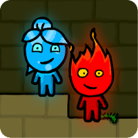

# 🔥 Fireboy & Watergirl: Master Collection (Series 1 - 6) 💧
> **WebRTC P2P Multiplayer Edition** — Mainkan semua seri Fireboy and Watergirl (1 s/d 6) langsung di browser secara online bersama temanmu tanpa video streaming dan tanpa lag!



---

## 🌟 Daftar Series yang Tersedia
1. **Series 1: In the Forest Temple (Kuil Hutan)** — *32 Level • Teka-teki klasik tuas, tombol injak, dan kolam lava & air.*
2. **Series 2: In the Light Temple (Kuil Cahaya)** — *41 Level • Prisma pemantul cahaya, cermin putar, dan sensor laser.*
3. **Series 3: In the Ice Temple (Kuil Es)** — *37 Level • Lantai es licin, tumpukan salju, serta sinar pembeku & pencair.*
4. **Series 4: In the Crystal Temple (Kuil Kristal)** — *39 Level • Portal teleportasi kristal antar dimensi dan warp balok.*
5. **Series 5: Elements (Elemen)** — *49 Level • Petualangan gabungan Kuil Api, Air, Angin, Es, Cahaya, dan Hutan.*
6. **Series 6: Fairy Tales (Negeri Dongeng)** — *31 Level • Mengarahkan peri ajaib warna-warni untuk membuka pintu misterius.*

---

## 🎮 Panduan Kontrol
| Karakter | Tombol Desktop | Keterangan |
| :--- | :--- | :--- |
| 🔥 **Fireboy** | `↑` Lompat, `←` Kiri, `→` Kanan | Tahan lava api, mati jika menyentuh air |
| 💧 **Watergirl** | `W` Lompat, `A` Kiri, `D` Kanan | Tahan kolam air, mati jika menyentuh lava |
| 🟩 **Goo Hijau** | — | **Keduanya mati** jika menyentuh cairan hijau |

*Tersedia juga dukungan **Mobile Virtual Touch D-Pad** untuk layar sentuh HP/Tablet.*

---

## 🚀 Fitur Unggulan P2P Multiplayer
- **Direct P2P Synchronization**: Kedua pemain menjalankan game engine Phaser native secara lokal di 60 FPS tanpa video streaming yang berat.
- **Bisa Dimainkan Jarak Jauh**: Menggunakan WebRTC DataChannel dengan STUN & TURN server gratis, mendukung koneksi antar jaringan Wi-Fi/data seluler yang berbeda.
- **Sistem Room & QR Code**: Host dapat membagikan link room atau QR code instan untuk teman HP/PC.
- **In-Game Chat & Emotes**: Fitur obrolan teks dan tombol reaksi cepat langsung di dalam game tanpa mengganggu tombol gerakan karakter.
- **Static Hosting**: Siap dideploy secara instan ke Vercel, Netlify, atau GitHub Pages secara gratis.

---

## 🛠️ Menjalankan Secara Lokal (Offline / LAN)
Cukup jalankan file `start.bat`:
```cmd
start.bat
```
Atau menggunakan Node.js secara manual:
```bash
node local_server.js
```
Akses di browser: `http://localhost:3000`

---

## ☁️ Deployment ke Vercel
Proyek ini telah dikonfigurasi dengan `vercel.json` sebagai static web application murni:
1. Hubungkan repository GitHub ini ke akun [Vercel](https://vercel.com).
2. Framework Preset: **Other**.
3. Deploy! Website langsung online dan dapat diakses bersama teman dari seluruh dunia.

---
*Dibuat untuk tujuan edukasi & preservasi game klasik Flash/HTML5 oleh Oslo Albet.*
